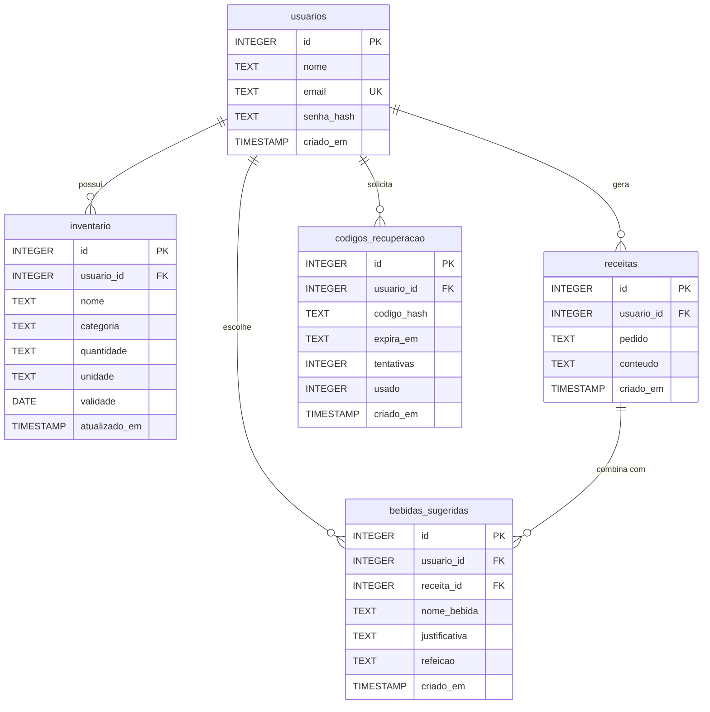

# Banco de dados do TastIA

O TastIA usa **SQLite**. O arquivo é `banco_dados/tastia.db` e é criado automaticamente na primeira execução, por `banco_dados/create_db.py`.

- Rodar a criação várias vezes é seguro: as tabelas só são criadas se ainda não existirem.
- Se o banco for antigo e faltar alguma coluna (`inventario.unidade` ou `bebidas_sugeridas.refeicao`), ela é adicionada sozinha.
- Para recomeçar do zero, apague o arquivo `tastia.db`. Ele será recriado vazio.

## Como as tabelas se relacionam

Em palavras: um usuário tem vários ingredientes, receitas, bebidas e códigos de recuperação. Uma bebida pode (ou não) estar ligada a uma receita.

## As tabelas

### `usuarios`: quem usa o sistema

| Coluna | O que guarda |
|---|---|
| `id` | Identificador (automático) |
| `nome` | Nome do usuário |
| `email` | E-mail, **único** (não pode repetir) |
| `senha_hash` | A senha **criptografada**. A senha de verdade nunca é guardada |
| `criado_em` | Data do cadastro |

### `inventario`: os ingredientes de cada usuário

| Coluna | O que guarda |
|---|---|
| `usuario_id` | Dono do ingrediente |
| `nome` | Nome do ingrediente (até 100 caracteres) |
| `categoria` | Categoria, como "Legumes" (padrão "Outros") |
| `quantidade` | Quantidade, guardada como texto |
| `unidade` | Unidade, como "unidade" ou "g" (padrão "unidade") |
| `validade` | Data de validade, no formato `AAAA-MM-DD` |
| `atualizado_em` | Última vez que foi somado ou editado |

Observações:
- A validade é opcional no banco, mas **obrigatória** ao confirmar itens vindos da foto.
- Ingrediente repetido não gera outra linha: o sistema compara o nome sem acento e em minúsculas, **soma a quantidade** e mantém a **validade mais próxima**. Isso é feito pelo código, não pelo banco.

### `receitas`: histórico de receitas

| Coluna | O que guarda |
|---|---|
| `usuario_id` | Dono da receita |
| `pedido` | O que o usuário pediu |
| `conteudo` | O texto completo da receita, já limpo |
| `criado_em` | Quando foi salva |

Título, tempo, porções, ingredientes e passos **não têm coluna própria**. Eles são lidos do `conteudo` na hora de mostrar o histórico.

### `bebidas_sugeridas`: bebidas escolhidas

| Coluna | O que guarda |
|---|---|
| `usuario_id` | Dono da escolha |
| `receita_id` | Receita ligada à bebida. Fica **vazio** se a bebida foi salva sozinha |
| `nome_bebida` | Nome da bebida |
| `justificativa` | Por que ela combina |
| `refeicao` | Prato informado (até 300 caracteres), usado quando não há receita |
| `criado_em` | Quando foi escolhida |

A mesma bebida não se repete na mesma receita. Sem receita, o repetido é permitido.

### `codigos_recuperacao`: recuperar a senha

| Coluna | O que guarda |
|---|---|
| `usuario_id` | Usuário que pediu o código |
| `codigo_hash` | O código de 6 dígitos **criptografado** (o código em si nunca é guardado) |
| `expira_em` | Data e hora de validade. O código vale **10 minutos** |
| `tentativas` | Quantas vezes o código foi digitado errado. O limite é **5** |
| `usado` | `0` = ainda não usado, `1` = já usado |

## Pontos de atenção

- **Chaves estrangeiras:** elas estão declaradas, mas o SQLite só as aplica com `PRAGMA foreign_keys = ON`, e o projeto **não ativa** isso. Por isso, a integridade depende do código. Por exemplo, ao excluir uma receita, as rotas apagam também as bebidas ligadas a ela.
- **Onde fica o SQL:** os comandos SQL estão espalhados pelas rotas e pelo `app.py`, e não reunidos na pasta `banco_dados/`.
- **Não versionar o banco:** o `tastia.db` guarda dados reais dos usuários, então não deve ir para o GitHub.
